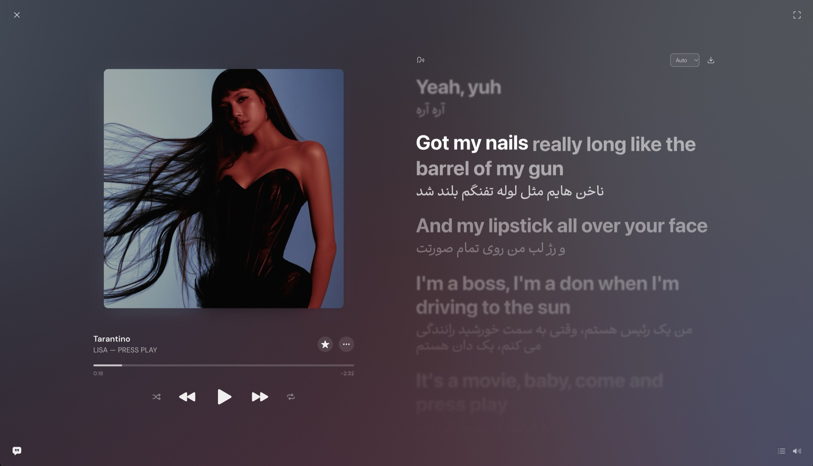

# BitChord Desktop

Run **[BitChord](https://github.com/kushagrasinghx/BitChord)**, the aesthetic YouTube Music client by [@kushagrasinghx](https://github.com/kushagrasinghx), on **macOS and Linux**, plus a few features ported from the Android app.

> **All credit for BitChord goes to [kushagrasinghx/BitChord](https://github.com/kushagrasinghx/BitChord) and its contributors.**
> This repo has no app code of its own. It contains a patch and an installer that build the upstream web player (`web/`) and its browser extension, and run them locally.
> It is not affiliated with BitChord, YouTube or Google. If you enjoy BitChord, star and support the [original project](https://github.com/kushagrasinghx/BitChord).



<sub>Full-screen player with dual-language lyrics: the original line in bold, its translation below.</sub>

## What you get

- The upstream BitChord web player, served locally at `http://localhost:5173` and started automatically at login.
- The official BitChord browser extension (handles YouTube Music playback and sign-in), built to open your local player.
- Only about 50 MB is installed. Build files are deleted afterwards.

### Added on top of upstream (ported from the Android app)

| Feature | Where |
|---|---|
| **Prefer song over music video**: music videos play as their album song. Uses YouTube's own song↔video pair first, then the Android app's search and `TrackMatcher` fallback. | Settings → Playback |
| **Convert to audio / Convert to video** for the current track. Resumes at the matching moment, using YouTube's time map when one exists. | Track menu of the now-playing song |
| **Lyrics translation**: a port of the Android `LyricsTranslation`. Keeps line and word timing, runs in batches, caches results, and renders RTL languages right-to-left. 33 target languages. | 🌐 button beside the lyrics source |
| **Dual-language lyrics**: *Original bold, translation below*, *Translation bold, original below*, or *Translation only*. | Lyrics language menu, Lyrics settings |
| **Always translate**: every song's lyrics open translated. The 🌐 button still switches one song back, and songs already in your language are left as they are. | Lyrics settings → Translation |

## Install

Requirements: **Node.js 22+**, **git**, **python3** and a Chromium browser (Chrome, Edge or Brave).
**macOS / Linux.** On a Mac: `brew install node` (git and python3 come with the Xcode command line tools).

```bash
git clone https://github.com/Goodrich347/BitChord-Desktop.git
cd BitChord-Desktop
./install.sh
```

The installer:
1. fetches upstream BitChord at a pinned commit (`acf219a`, upstream `main`, v1.9.1)
2. applies `patches/*.patch`
3. builds the site and the extension (downloads about 560 MB of build dependencies, deleted at the end)
4. installs the result to `~/Library/Application Support/BitChord` (macOS) or `~/.local/share/bitchord` (Linux)
5. registers a tiny local server (`launchd` on macOS, `systemd --user` on Linux)

Then do this once in the browser:
1. Open `chrome://extensions` and turn on **Developer mode**.
2. Click **Load unpacked** and pick the `extension` folder printed by the installer.
3. Open `http://localhost:5173`, then choose **⋮ → Cast, save and share → Install page as app** to get a Dock or launcher icon.

**Update:** `git pull && ./install.sh`, then press **Reload** on the extension card.
**Uninstall:** `./uninstall.sh`, then remove the extension.

### Options (environment variables)

| Variable | Default | Purpose |
|---|---|---|
| `BITCHORD_HOME` | see above | Install location |
| `BITCHORD_COMMIT` | pinned | Build a different upstream commit (the patch may not apply) |
| `BITCHORD_NO_SERVICE=1` | off | Skip autostart. Run `python3 <home>/server.py` yourself |
| `VITE_PARTY_SERVER_URL` | `https://api.bitchord.kushagrasingh.in` | Listen Together server (unverified for web) |

### Windows

Requirements: **Node.js 22+** and **git**. Install them with `winget install OpenJS.NodeJS.LTS Git.Git`. Python is not needed, because the server on Windows runs on Node.

```powershell
git clone https://github.com/Goodrich347/BitChord-Desktop.git
cd BitChord-Desktop
.\install.cmd
```

You can also double-click `install.cmd`. No administrator rights are needed. The installer:

- installs to `%LOCALAPPDATA%\BitChord`
- starts a hidden local server and adds it to your Startup folder (`BitChord Server.vbs`), so it runs at every login

The browser steps are the same as on macOS. Use `edge://extensions` in Edge.

**Update:** `git pull`, then `.\install.cmd`.
**Uninstall:** `.\uninstall.cmd`.

## Notes and limitations

- The port is fixed at **5173**, because the extension only trusts that origin.
- Android-only features (Automix tuning, bit-perfect USB output, system EQ) are not part of the web player.
- In *Original bold* mode, an RTL translation under an LTR line keeps the line's alignment, because the lyrics renderer has no per-line direction.
- Translation uses Google's public web endpoint, the same one the Android app uses. It may stop working at any time.
- Use at your own discretion and in line with your local laws and YouTube's Terms of Service. See upstream's [disclaimer](https://github.com/kushagrasinghx/BitChord#disclaimer--legal-notice).

## License

GPL-3.0, the same as upstream BitChord (see `LICENSE`). The patch is a derivative work of BitChord. The corresponding source is upstream at the pinned commit plus `patches/`.
